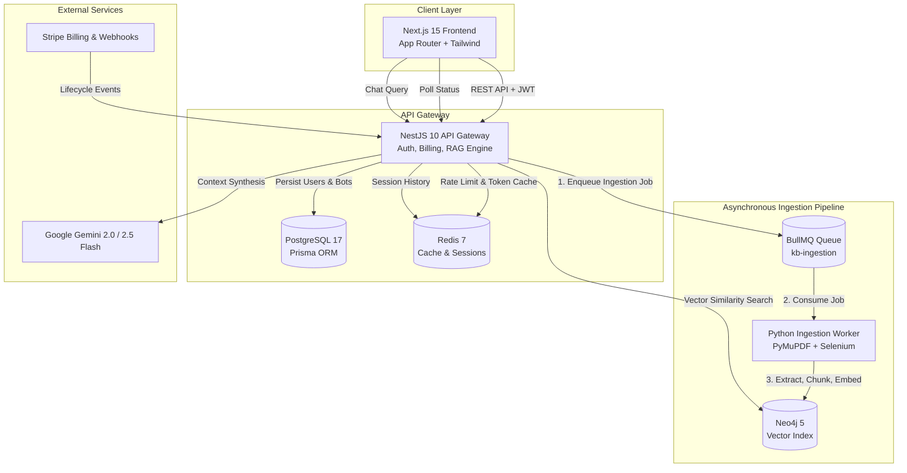

<div align="center">

# KSTM — Multi-Modal RAG Platform & Bot Builder

**Production-grade asynchronous knowledge base ingestion, graph vector retrieval, and conversational AI platform.**

[](https://turbo.build/)
[](https://nextjs.org/)
[](https://nestjs.com/)
[](https://python.org/)
[](https://neo4j.com/)
[](https://redis.io/)
[](https://postgresql.org/)
[](LICENSE)

</div>

---

## Overview

**KSTM** is a full-stack, distributed AI knowledge assistant platform. It enables users to connect diverse document sources (PDFs, CSVs, JSON, raw text, and live dynamic websites), automatically extract and index them into an isolated **Neo4j vector store**, and converse with domain-specialized AI assistants with persistent memory, prompt templating, and Stripe-metered usage.

Unlike naive OpenAI wrappers that block HTTP requests while crunching large documents, KSTM is built as a **distributed system** with an event-driven task queue (BullMQ), dedicated Python parsing workers, native NestJS vector search, and automatic local multilingual embedding fallbacks.

---

## Architecture



---

## Core Capabilities

- **Multi-Modal Document Parsing**: Concurrently processes PDF documents via PyMuPDF, tabular CSVs, structured JSON schemas, and raw text files.
- **Dynamic JavaScript Web Scraping**: Headless Chromium + Selenium scraper extracts rich text and markdown links from single-page web applications.
- **Asynchronous Task Queue (BullMQ)**: Heavy document chunking and vector indexing run in background workers with real-time status polling (`INDEXING` $\rightarrow$ `READY` $\rightarrow$ `FAILED`).
- **Graph Vector Search (Neo4j)**: Chunks are indexed with vector embeddings scoped strictly to isolated knowledge base IDs (`kb_id`), preventing cross-tenant leakage.
- **Offline / Quota-Resilient Embeddings**: Integrates local 768-dimensional multilingual fallback embeddings in both Python and TypeScript when cloud API quotas are exhausted.
- **Full Stripe Monetization**: Free tier allowances (bot creation and chat message quotas), subscription checkout, and cryptographic webhook handlers.
- **Custom System Prompt Studio**: Dynamic `{{context}}` variable interpolation, temperature controls, and public/private access sharing.

---

## Monorepo Structure

```text
kstm/
├── apps/
│   ├── web/               # Next.js 15 frontend application (Tailwind, Radix UI, Framer Motion)
│   ├── api/               # NestJS 10 backend gateway & native RAG engine (Prisma, BullMQ, Neo4j)
│   └── ai-service/        # Python 3.11 background ingestion worker (PyMuPDF, Selenium, Neo4j)
├── docker-compose.yml     # Infrastructure (PostgreSQL 17, Redis 7, Neo4j 5.23, AI Worker)
├── package.json           # Turborepo & pnpm workspace root
├── pnpm-workspace.yaml    # Workspace definition
└── turbo.json             # Build and task orchestration pipeline
```

---

## Tech Stack

| Layer | Technologies |
| :--- | :--- |
| **Monorepo Tooling** | Turborepo, pnpm Workspaces |
| **Frontend** | Next.js 15, React 18, Tailwind CSS, Radix UI, Framer Motion, Lucide Icons |
| **API Gateway** | NestJS 10, TypeScript, Passport.js, JWT, Zod, Class-Validator, Throttler |
| **Background Processing** | BullMQ, Redis 7 |
| **Data & ORM** | PostgreSQL 17, Prisma ORM 6 |
| **Vector Database** | Neo4j 5.23 (Vector Indexing, Cypher) |
| **AI Ingestion Worker** | Python 3.11, PyMuPDF, BeautifulSoup4, Selenium, Headless Chromium |
| **LLMs & Embeddings** | Google Gemini 2.5 Flash (`@google/genai`), `text-embedding-004`, Local 768d Embeddings |
| **Payments** | Stripe API & Webhook verification |

---

## Getting Started

### Prerequisites

Ensure you have the following installed:
- [Node.js](https://nodejs.org/) (>= 20.x)
- [pnpm](https://pnpm.io/) (>= 9.x)
- [Python](https://python.org/) (>= 3.11)
- [Docker](https://www.docker.com/) & Docker Compose

### 1. Clone & Install Dependencies

```bash
git clone https://github.com/yeabalex/kstm.git
cd kstm

# Install monorepo dependencies
pnpm install
```

### 2. Configure Environment Variables

Copy the example environment files and configure your credentials:

```bash
cp .env.example .env
cp apps/api/.env.example apps/api/.env
cp apps/web/.env.example apps/web/.env
cp apps/ai-service/.env.example apps/ai-service/.env
```

Key environment variables to provide:
- `GOOGLE_API_KEY` (Google AI Studio Gemini API key)
- `JWT_SECRET` (Random secret for authentication tokens)
- `STRIPE_API_KEY` & `STRIPE_WEBHOOK_SECRET` (Optional for billing)

### 3. Start Infrastructure

Launch PostgreSQL, Redis, and Neo4j using Docker Compose:

```bash
pnpm infra:up
```

Verify service health:
- Neo4j Browser: [http://localhost:7474](http://localhost:7474) (credentials: `neo4j` / `password123`)
- PostgreSQL: `localhost:5433` (or configured port)
- Redis: `localhost:6379`

### 4. Run Database Migrations

```bash
pnpm db:push
```

### 5. Setup Python AI Worker

```bash
cd apps/ai-service
python3 -m venv .venv
source .venv/bin/activate
pip install -r requirements.txt
cd ../..
```

### 6. Run the Full Stack

Launch all services concurrently using Turborepo:

```bash
pnpm dev
```

- **Frontend**: [http://localhost:8080](http://localhost:8080)
- **API Gateway**: [http://localhost:3000](http://localhost:3000)

---

## Testing & Quality

All packages include dedicated automated test suites:

```bash
# Run all tests across the monorepo
pnpm test

# Run linter across all packages
pnpm lint

# Build all packages for production
pnpm build
```

---

## License

This project is licensed under the [MIT License](LICENSE).
