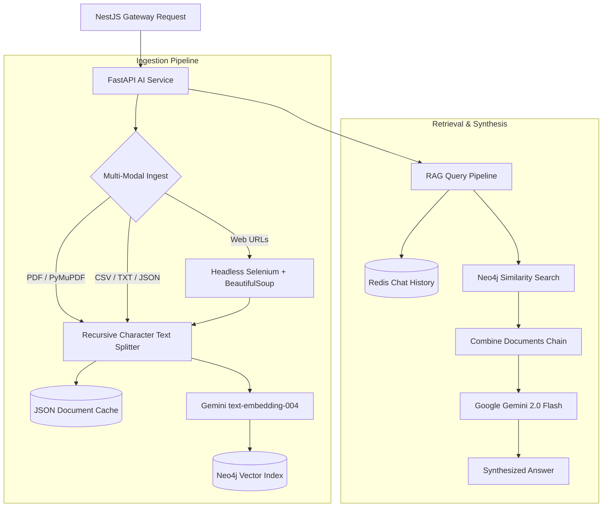

# KSTM-AI FastAPI Intelligence & RAG Microservice

High-performance asynchronous AI microservice engineered with FastAPI, LangChain, Google Gemini, Neo4j Vector DB, and Redis. Provides multi-modal knowledge base ingestion (PDF, CSV, TXT, JSON, and dynamic web scraping) and contextual RAG conversational retrieval with persistent session memory.

---

## Architecture Overview



---

## Tech Stack & Core Libraries

- **API Framework**: [FastAPI](https://fastapi.tiangolo.com/) (Asynchronous Python 3.11+) with [Uvicorn](https://www.uvicorn.org/)
- **LLM & Embeddings**: Google Gemini 2.0 Flash (`gemini-2.0-flash`) & `models/text-embedding-004`
- **Vector Database**: [Neo4j](https://neo4j.com/) via `langchain-neo4j` vector store
- **Orchestration**: [LangChain](https://www.langchain.com/) / `langchain-core` retrieval chains
- **Document Processing**: `PyMuPDF` (fitz), `BeautifulSoup4`, and `Selenium`
- **Memory & Caching**: Redis session store with JSON caching
- **Data Validation**: Pydantic v2 with `ConfigDict`
- **Testing**: Pytest with `pytest-asyncio` and `TestClient`

---

## Key Features

- **Multi-Modal Document Parsing**: Ingests and indexes multiple document formats (PDFs from URLs/local files, tabular CSVs, raw text, and structured JSON).
- **Dynamic Web Scraping with Headless Chrome**: Automatically extracts rich DOM elements (headings, paragraphs, lists, and formatted Markdown hyperlinks) from dynamic JavaScript single-page apps.
- **Secure File Caching**: Replaced insecure pickle serialization with structured, auditable JSON cache storage keyed by MD5 URL/file hashes.
- **Persistent Conversational Memory**: Stores serialized chat session turns (`HumanMessage`, `AIMessage`) in Redis with automatic TTL and graceful in-memory fallback.
- **Threadpool Offloading**: CPU-bound document chunking and vector index operations are offloaded using `starlette.concurrency.run_in_threadpool` to prevent blocking the FastAPI async event loop.

---

## API Endpoints

### Health Check
- `GET /health` - Service heartbeat, Redis connection status, and uptime verification.

### Knowledge Base Ingestion
- `POST /create-bot` - Concurrently downloads, parses, chunks, and indexes all knowledge sources for a bot into Neo4j vector store.

### Conversational Retrieval (RAG)
- `POST /query` - Executes semantic similarity search against Neo4j vector index, retrieves relevant context, loads past conversation memory from Redis, and synthesizes answers via Gemini.

---

## Getting Started

### Prerequisites
- Python >= 3.11
- Neo4j Instance (with Vector Index support)
- Redis server
- Google Gemini API Key

### Installation

```bash
# Clone the repository
git clone https://github.com/yeabalex/KSTM-AI-SERVICE_FASTAPI.git
cd KSTM-AI-SERVICE_FASTAPI

# Create and activate virtual environment
python3 -m venv venv
source venv/bin/activate

# Install dependencies
pip install -r requirements.txt
```

### Environment Configuration

Copy `.env.example` to `.env` and fill in your credentials:

```bash
cp .env.example .env
```

### Running the Application

```bash
# Start FastAPI service with hot-reload
uvicorn src.main:app --host 0.0.0.0 --port 8000 --reload
```

### Running the Test Suite

```bash
# Execute Pytest integration & validation test suite
pytest tests/ -v
```

---

## Docker Deployment

Build and run with Docker:

```bash
# Build Docker image
docker build -t kstm-fastapi-service .

# Run container
docker run -p 8000:8000 --env-file .env kstm-fastapi-service
```

---

## License

MIT License. Designed and built by [Yeab Alex](https://github.com/yeabalex).
