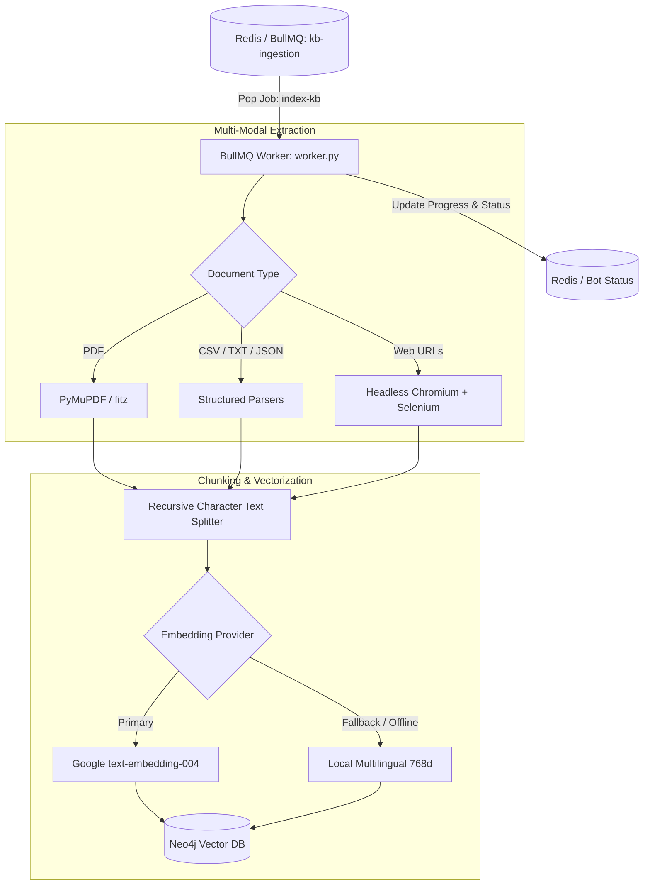

# @kstm/ai-service — AI Ingestion & Document Processing Worker

High-performance Python background worker powering knowledge base ingestion for KSTM. Consumes asynchronous jobs from Redis via BullMQ, extracts content across diverse formats (PDF, CSV, TXT, JSON, and dynamic JavaScript web pages using headless Selenium), generates vector embeddings (Google Gemini and local multilingual fallback), and indexes chunks into Neo4j vector storage.

---

## Architecture Overview



---

## Tech Stack & Core Libraries

- **Runtime**: Python 3.11+
- **Task Queue**: BullMQ consumer backed by Redis
- **LLM & Embeddings**: Google Gemini (`models/text-embedding-004`) & Local multilingual embedding fallback
- **Vector Database**: [Neo4j](https://neo4j.com/) via `neo4j` Python driver & Cypher queries
- **Document Processing**: `PyMuPDF` (fitz), `BeautifulSoup4`, `Selenium` with headless Chromium
- **Testing**: `pytest` and `pytest-asyncio` (18 unit & pipeline tests)

---

## Key Features

- **Asynchronous Background Ingestion**: Non-blocking extraction of multi-page documents and dynamic web assets.
- **Dynamic Web Scraping with Headless Chrome**: Automatically renders client-side JavaScript, extracts meaningful text, cleans boilerplate, and formats links.
- **Resilient Fallback Embeddings**: Seamlessly falls back to local 768-dimensional multilingual embeddings if Google API quotas are exceeded or network connectivity drops.
- **Structured JSON Caching**: Avoids redundant parsing of previously ingested files using deterministic MD5 content hashes.
- **Graceful Error Handling & Bot Status Updates**: Updates job progress in Redis so users receive real-time feedback in the UI.

---

## Development & Testing

This service is part of the KSTM Turborepo monorepo.

### Local Setup

```bash
cd apps/ai-service

# Create and activate virtual environment
python3 -m venv .venv
source .venv/bin/activate

# Install dependencies
pip install -r requirements.txt

# Run the BullMQ worker
python src/worker.py

# Run unit tests
pytest tests/ -v
```

### Monorepo Commands (from root)

```bash
# Run tests via Turbo
pnpm --filter @kstm/ai-service test

# Run worker via Turbo
pnpm --filter @kstm/ai-service dev
```
