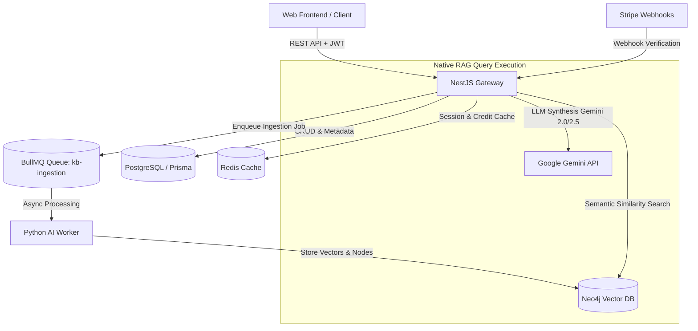

# @kstm/api — NestJS API Gateway & RAG Engine

Production-grade NestJS backend microservice powering the KSTM platform. Handles authentication, Stripe subscription billing, bot persona customization, relational metadata via Prisma (PostgreSQL), asynchronous document ingestion queuing via BullMQ, and high-performance native RAG vector retrieval from Neo4j with Google Gemini and local multilingual fallback embeddings.

---

## Architecture Overview



---

## Tech Stack & Core Dependencies

- **Framework**: [NestJS 10](https://nestjs.com/) (TypeScript)
- **Database & ORM**: PostgreSQL 17 with [Prisma ORM 6](https://www.prisma.io/)
- **Distributed Queue**: BullMQ (`@nestjs/bullmq`) with Redis
- **Vector Search & Storage**: Neo4j (`neo4j-driver`) with vector similarity index
- **LLM & Embeddings**: Google GenAI SDK (`@google/genai`) with local multilingual embedding fallback
- **Authentication**: Passport.js, `@nestjs/jwt`, `bcrypt`
- **Cache & Rate Limiting**: Redis with `ioredis` & `@nestjs/throttler`
- **Validation**: Schema-level Zod & Class-Validator DTOs
- **Payment Processing**: Stripe SDK (`stripe`) with cryptographic webhook signature verification
- **Testing**: Jest unit & service test suite

---

## Key Features

- **Robust Authentication & Access Control**: Secure bcrypt password hashing, JWT strategy guards, sanitized user payloads, and automatic Free Tier credit initialization.
- **Asynchronous Ingestion Queuing**: Offloads document parsing and vector indexing to background BullMQ workers without blocking client requests.
- **Native NestJS RAG Retrieval**: Direct vector search against Neo4j indices and context synthesis using Gemini 2.5 Flash.
- **Embedding Fallback Resilience**: Falls back to deterministic local multilingual embeddings if external API quotas are exhausted.
- **Stripe Subscription Lifecycle**: Checkout session creation and event-driven webhook processing (`invoice.payment_succeeded`, `customer.subscription.deleted`) for tiered access.
- **Enterprise Error Handling & Logging**: Standardized NestJS `HttpException` hierarchy with structured NestJS `Logger`.

---

## API Endpoints

### Authentication (`/api/v1/auth`)
- `POST /api/v1/auth/login` - Authenticate user credentials and issue JWT access token.
- `POST /api/v1/auth/validate` - Verify JWT token validity.

### Users (`/api/v1/user`)
- `POST /api/v1/user/register` - Register a new user and initialize Free Tier credits.
- `GET /api/v1/user/:id` - Fetch user profile metadata.

### Bots & Knowledge Bases (`/api/v1/bot`)
- `POST /api/v1/bot/create` - Provision bot persona and enqueue multi-source ingestion job in BullMQ.
- `GET /api/v1/bot/status/:botId` - Real-time polling endpoint for BullMQ background indexing status.
- `GET /api/v1/bot/all/:userId` - Retrieve all bots owned by a user.
- `GET /api/v1/bot/detail/:botId` - Fetch detailed bot configuration and knowledge sources.
- `PATCH /api/v1/bot/access` - Toggle bot public/private visibility.

### Conversational Retrieval (`/api/v1/query`)
- `POST /api/v1/query/ask` - Validate user credits, run Neo4j similarity search, synthesize response with Gemini, and manage session turns in Redis.
- `GET /api/v1/query/sessions/:botId` - Fetch conversational history sessions for a bot.

### Stripe Billing (`/api/v1/stripe`)
- `POST /api/v1/stripe/checkout` - Create Stripe subscription checkout session.
- `POST /api/v1/stripe/webhook` - Handle asynchronous Stripe lifecycle events with raw body signature verification.

---

## Development & Testing

This package is managed inside the KSTM Turborepo monorepo.

```bash
# Run database migrations
pnpm --filter @kstm/api run db:migrate

# Start development server
pnpm --filter @kstm/api run dev

# Run unit tests
pnpm --filter @kstm/api test

# Run linter
pnpm --filter @kstm/api run lint
```
