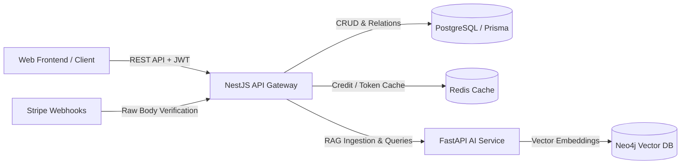

# KSTM-AI NestJS API Gateway & Backend

Production-ready NestJS backend microservice powering the KSTM-AI knowledge base & conversational bot platform. Handles authentication, Stripe subscription billing, bot customization, relational metadata via Prisma (PostgreSQL), and proxies RAG retrieval requests to the FastAPI AI microservice.

---

## Architecture Overview



---

## Tech Stack & Core Dependencies

- **Framework**: [NestJS 10](https://nestjs.com/) (TypeScript)
- **Database & ORM**: PostgreSQL 16 with [Prisma ORM 6](https://www.prisma.io/)
- **Authentication**: Passport.js, `@nestjs/jwt`, `bcrypt`
- **Cache & Rate Limiting**: Redis with `ioredis` & `@nestjs/cache-manager`
- **Validation**: Schema-level Zod & Class-Validator DTOs
- **Payment Processing**: Stripe SDK (`stripe`) with cryptographic webhook signature verification
- **Testing**: Jest unit & service integration test suite

---

## Key Features

- **Robust Authentication & Access Control**: Secure bcrypt password hashing, JWT strategy guards, sanitized user payloads, and automatic Free Tier credit initialization.
- **Bot & Knowledge Base Management**: Create, customize, and configure bot personas, temperature, system prompts, and multi-source knowledge bases (PDF, CSV, TXT, JSON, Web URLs).
- **Stripe Subscription Lifecycle**: Checkout session creation and event-driven webhook processing (`invoice.payment_succeeded`, `customer.subscription.deleted`) for tiered access.
- **RAG Proxy & Credit Enforcement**: Pre-validates user subscription/credit allowances before delegating vector queries to the FastAPI engine.
- **Enterprise Error Handling & Logging**: Standardized NestJS `HttpException` hierarchy with structured NestJS `Logger`.

---

## API Endpoints

### Authentication (`/auth`)
- `POST /auth/login` - Authenticate user credentials and issue JWT access token.
- `POST /auth/validate` - Verify JWT token validity.

### Users (`/user`)
- `POST /user/register` - Register a new user and initialize Free Tier credits.
- `GET /user/:id` - Fetch user profile metadata.

### Bots & Knowledge Bases (`/bot`)
- `POST /bot/create` - Provision bot persona and trigger multi-source knowledge base ingestion.
- `GET /bot/all/:userId` - Retrieve all bots owned by a user.
- `GET /bot/detail/:botId` - Fetch detailed bot configuration and knowledge sources.
- `PATCH /bot/access` - Toggle bot public/private visibility.

### Knowledge Base Queries (`/query`)
- `POST /query/ask` - Validate user credits, forward query to FastAPI AI engine, and decrement chat credits.

### Stripe Billing (`/stripe`)
- `POST /stripe/checkout` - Create Stripe subscription checkout session.
- `POST /stripe/webhook` - Handle asynchronous Stripe lifecycle events with raw body signature verification.

---

## Getting Started

### Prerequisites
- Node.js >= 20.x
- PostgreSQL instance
- Redis server

### Installation

```bash
# Clone the repository
git clone https://github.com/yeabalex/KSTM-AI-NESTJS_BACKEND.git
cd KSTM-AI-NESTJS_BACKEND

# Install dependencies
npm ci
```

### Environment Configuration

Copy `.env.example` to `.env` and configure your credentials:

```bash
cp .env.example .env
```

### Database Migration

```bash
# Generate Prisma Client and run migrations
npx prisma generate
npx prisma db push
```

### Running the Application

```bash
# Development mode with hot-reload
npm run start:dev

# Production build
npm run build
npm run start:prod
```

### Running Tests & Linting

```bash
# Execute Jest unit and service test suites
npm test

# Run ESLint validation and auto-fixes
npm run lint
```

---

## Docker Deployment

Build and run the standalone containerized service:

```bash
# Build Docker image
docker build -t kstm-nestjs-backend .

# Run container
docker run -p 3000:3000 --env-file .env kstm-nestjs-backend
```

---

## License

MIT License. Designed and built by [Yeab Alex](https://github.com/yeabalex).
